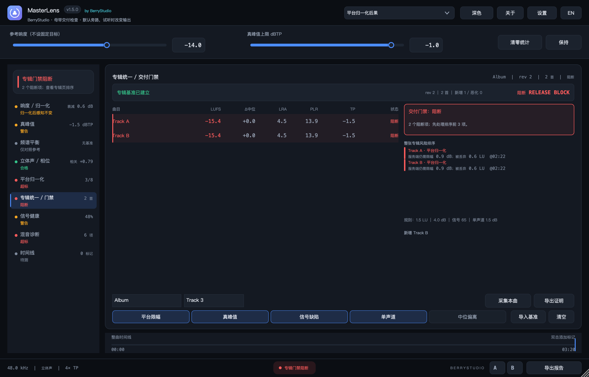
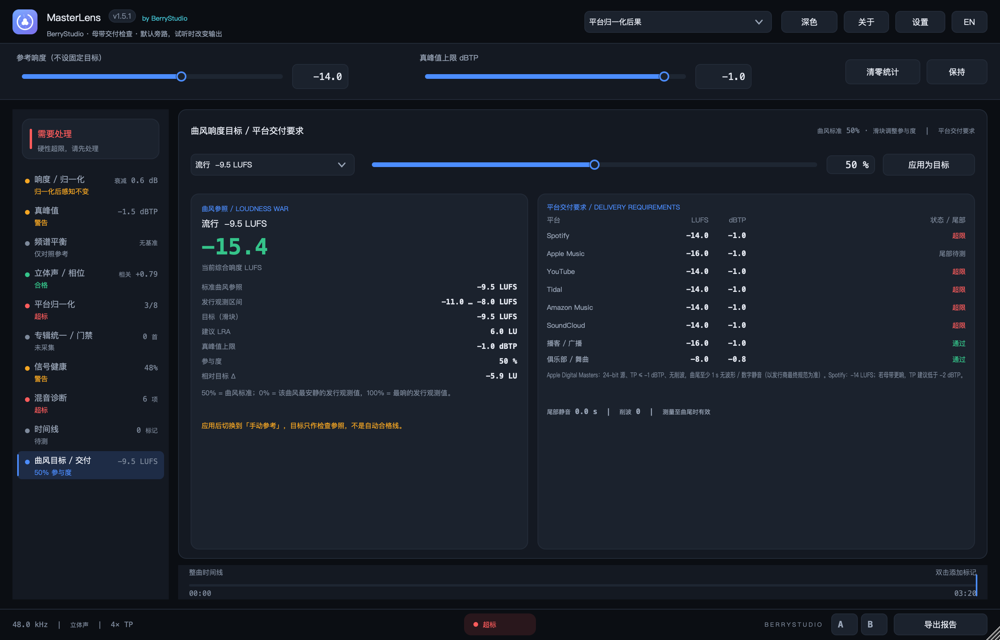
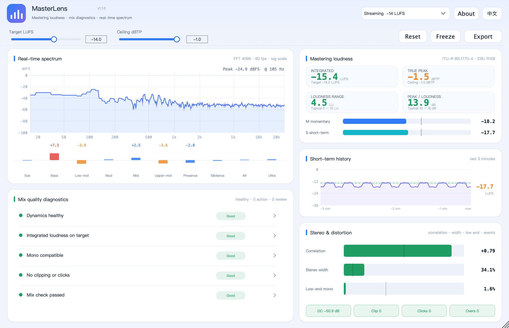
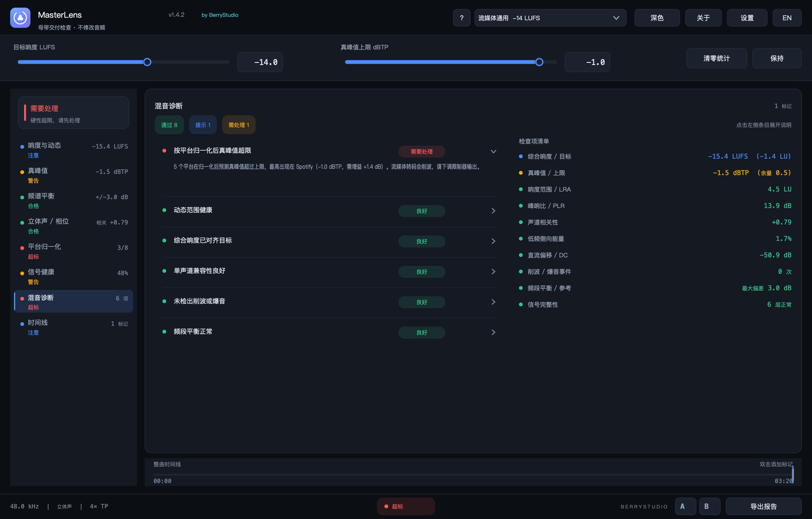
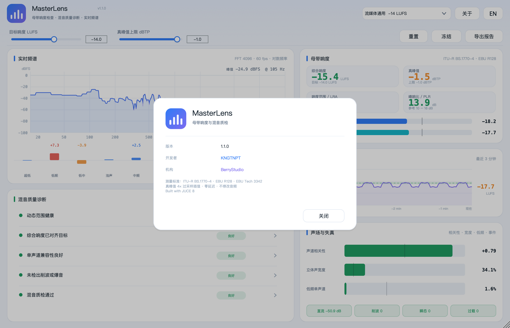
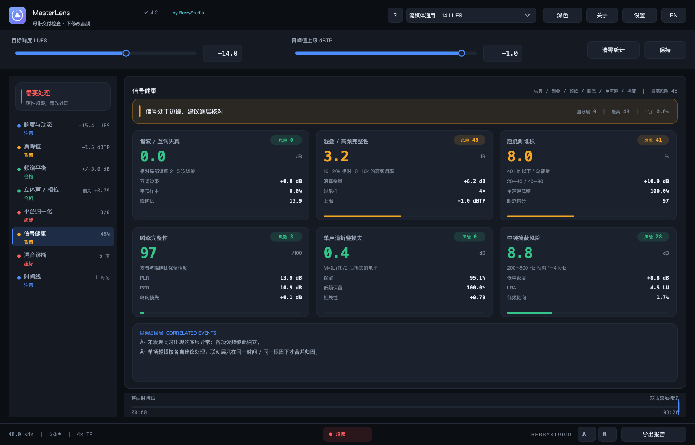
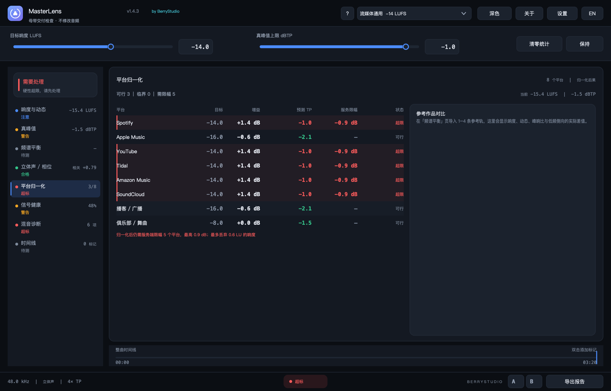
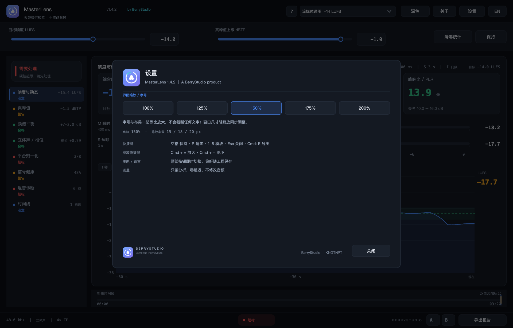
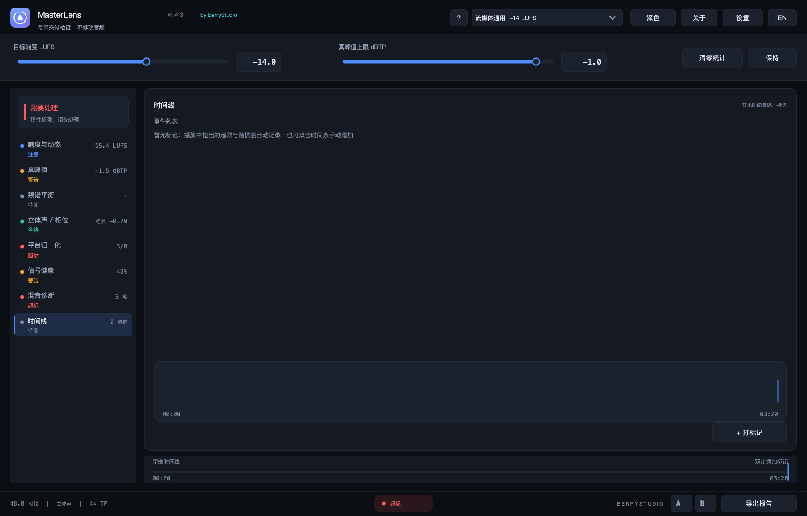

# MasterLens


**母带响度 · 平台归一化 · 信号健康**<br>
by **BerryStudio** · developer **KNGTNPT**<br>
macOS / Windows 音频总线插件（VST3 / AU / 独立版），C++17 + JUCE 8。

*Bilingual mastering loudness meter, platform-normalisation simulator and signal-integrity inspector for macOS and Windows — VST3, AU and standalone, built with C++17 and JUCE 8. Zero latency, bit-transparent bypass; only an explicit risk audition changes the output.*






插件默认**不处理任何音频**（零延迟、逐位旁路），只做测量、归一化后果模拟与信号缺陷诊断；只有点击问题试听时才会临时输出所选片段 / 频段。插在总线 / 母带链最后一级即可。

---

## English summary

- **Loudness (ITU-R BS.1770-4 / EBU R128)**: integrated with absolute + relative gating, momentary, short-term, LRA (EBU Tech 3342), PLR, and 4× oversampled true peak.
- **Platform normalisation**: eight destinations modelled as they behave — gain applied, predicted true peak before and after the service limiter, how much peak reduction the service has to perform, and how much of your limiting is thrown away. Compare every result with imported reference tracks (LUFS, LRA, PLR, low-side, sub share).
- **Signal integrity**: harmonic / intermodulation energy over a local spectral floor, flat-top (hard-clip) density, aliasing risk with top-octave flatness, sub-bass build-up, transient preservation, true mono-fold loss and mid-masking risk — plus a correlation layer that merges simultaneous anomalies into one attribution.
- **Mix diagnostics**: sample clipping, inter-sample overs, click/edit points, DC offset (4 s true mean), channel correlation, stereo width, mono-ness below 120 Hz, and a 10-band tonal balance that is **only compared with a reference track or album median** — never a built-in absolute curve — reported as concrete problems (mud, harshness, sibilance, missing air, sub excess, low-mid hole, bright/dark tilt, spectral holes) with bilingual explanations and fixes.
- **Visuals**: 8192-point FFT with **60 fps** spectrum analysis on the spectrum page (other pages stay at a low-load rate) and fractional-octave smoothing (1/3 octave below 250 Hz), power-domain averaging, peak-preserving tone restoration and cubic curve drawing; 3-minute short-term loudness history; correlation / width / low-end meters.
- **UI**: dark professional theme (light included), 100 / 125 / 150 / 175 / 200 % interface zoom that scales type, rows and the window together, bilingual Chinese/English (stored in plug-in state), keyboard shortcuts, A/B snapshot compare, exportable TXT / JSON / CSV report.
- **Basis, not genre targets**: choose platform-normalisation consequence, reference tracks, album median or a manual reference. The platform view shows the attenuation, service limiting and wasted loudness; reference / album views show LUFS, LRA, PLR and spectral deltas. Fixed genre loudness is no longer a pass line.
- **Album session / release gate**: capture tracks into a shared, versioned album snapshot; compare LUFS / LRA / PLR / TP / spectral deviation against the album median; rank platform, codec, signal, mono and inconsistency risks; toggle custom blocking rules; export a reproducible JSON + TXT proof with snapshot and evidence hashes and a previous-revision diff.
- **Risk audition and marker exchange**: signal-health cards solo the selected band from the live bus in sync with the DAW; detected problem regions get timestamps and can be looped explicitly. Export / import marker CSV for DAW marker tables. Host automation exposes reset / capture / proof / marker commands.
- **Verified**: `auval` passes, **46** offline DSP assertions pass (incl. −23.00 LUFS R128 calibration, mono-fold, sub-share, flat-top, defect-detector and audition bypass checks), ~0.31 % of one core at 48 kHz stereo. 1.5 UI benchmark: ~2.7 % loudness page, ~3.7 % spectrum page (60 fps), ~1.4 % album page.
- **Install**: open the DMG, run `安装 Install.command`, restart the DAW, insert on the master bus.

Build: `./scripts/make_dmg.sh` (universal binary, ad-hoc signed).

Performance / architecture notes: `docs/performance-1.5.1.md`.

---

## 1.5.1 更新

- **实时 Solo 跟随 DAW（修复 1.5.0 的循环回放）**：信号健康六张卡片现在从当前总线输入直接做频段滤波，跟随宿主播放头实时输出；DAW 暂停 / 停止时立即静音，不再随机循环历史片段。Esc 或再次点击停止。
- **问题区域时间戳循环（新增）**：当失真、混叠、超低堆积、瞬态、单声道折叠或中频掩蔽越过阈值时，自动生成带时间戳的问题区域（2 s 窗口）并写入时间线；点击问题区域即可循环该段、按对应频段试听。卡片点击 = 实时跟随，时间戳点击 = 定向循环，两种监听互不混淆。
- **窗口适配 MacBook Air 默认 DPI**：最小布局从 900×620 降到 **880×560**，默认基准从 1180×760 降到 **1120×700**；首次启动按屏幕可用区域自动选择缩放，旧工程保存的过大的 150%/200% 会在小屏上自动降到可显示档位，并预留标题栏 / Dock 空间。
- **曲风响度目标模块（恢复 + 独立页）**：新增「曲风目标 / 交付」页，恢复 36 组曲风 / 平台参照；滑块 0–100% 控制“响度战争参与度”：50% = 曲风标准，0% = 该曲风最安静的发行观测值，100% = 最响的发行观测值。目标 LUFS、建议 LRA、真峰值上限随滑块实时计算；「应用为目标」写入手动参考基准，不会偷偷改变平台模式。
- **平台交付要求表（独立模块）**：同一页并列 Spotify / Apple Music / YouTube / Tidal / Amazon / SoundCloud / 播客 / 俱乐部要求，包含 LUFS、dBTP、编解码器、归一化行为、真峰值与尾部静音检查；Apple Digital Masters 的曲尾 ≥1 s 无波形 / 数字静音作为单独状态，测量到尾部静音时才会判定（避免播放中途误报）。
- **尾部静音测量**：分析线程新增 trailing digital silence（-60 dBFS 阈值）计数，目标页 / 报告 / CSV 可读取；用于 Apple 曲尾交付检查。
- **报告扩展**：TXT / JSON / CSV 增加曲风目标、参与度、建议 LRA、平台编解码器与尾部静音字段。
- **验证**：**50** 项离线 DSP 断言通过（新增实时跟随、停止即静音、尾部静音测量）；`auval` 通过；版本号 **1.5.1**。

---

## 1.5.0 更新

- **判定基准重构（本版核心）**：固定曲风响度目标不再是合格线。顶部改为四种主基准：**平台归一化后果 / 参考轨 / 专辑中位 / 手动参考**。
  - 平台模式直接显示归一化后的衰减、服务端限幅、被丢弃响度。−4 LUFS 这类超高响度会明确说明“归一化后感知响度不变，损失的是动态余量”。
  - 参考轨 / 专辑中位模式显示 LUFS、LRA、PLR 与基线的差，只作差异提示，不自动判不合格。
  - 频谱平衡只对照参考轨 / 专辑中位；没有参考时明确显示“无基准”，不再套用粉噪目标曲线。
- **频谱 60 fps**：频谱页改为 60 Hz 分析与重绘（8192 FFT、分数倍频程平滑、峰值保持）；其他页面保持 30 Hz 更新，HOLD 时停止 FFT。离屏基准约 3.7% 单核。
- **专辑统一化检查（新增专辑页）**：逐首「采集本曲」写入共享、带修订号的专辑快照；并列 LUFS / LRA / PLR / TP / Δ中位 / 状态；标记偏离专辑中位阈值（LUFS、LRA、PLR、TP、频段、相关性）的曲目和段落。
- **专辑风险聚合与交付门禁**：按严重度排序平台归一化、编码 / TP、信号缺陷、单声道折叠、曲目间不一致；五个规则开关可自定义阻断项；输出阻断 / 放行结论。
- **基准 / 规则持久化、共享、版本化**：专辑快照、中位、参考轨快照、检查规则保存在 `album.json`；可导入 / 导出 JSON 供团队共享；保存上一版快照并自动 diff，只高亮新增或恶化项。
- **可复现交付证明**：专辑页「导出证明」输出 JSON + TXT，包含 schema / 版本 / 修订号、每首快照、中位、规则、门禁、风险排序、版本 diff、快照哈希与证据哈希（证据哈希不包含生成时间，可复算）。
- **问题联动试听**：信号健康六张卡片与专辑风险行可点击；自动循环最近 / 风险时间片段、按频段滤波、做 RMS 响度匹配、5 ms 淡入淡出与峰值保护。默认旁路逐位不变，Esc 停止。
- **DAW 标记交换与自动化（1.5 范围）**：时间线页可导出 / 导入标记 CSV（timecode / seconds / severity / text）。VST3 / AU 没有跨宿主标记写回 API，因此本版提供 CSV 交换而非声称直接写回每家 DAW；自动化参数提供 transport start 重置、stop 采集、stop 导出证明、命令选择（重置 / 采集 / 证明 / 标记 / 清空）。
- **厂商名**：`COMPANY_NAME` / VST3 vendor / AU 名称 / Bundle ID 统一为 **BerryStudio**（AU 显示 `BerryStudio: MasterLens`，VST3 厂商为 BerryStudio）。AU manufacturer code 仍为 `OrcA` 以保持已有工程兼容。
- **UI 修复**：版本号与 by BerryStudio 改为左侧品牌区动态布局，按可用宽度测量、必要时隐藏副标题，不再被右侧控件遮挡；标题副行明确“默认旁路，试听时改变输出”。
- **验证**：46 项离线 DSP 断言通过（新增试听旁路 / 激活 / 停止恢复）；`auval` 通过；专辑证明 JSON 可生成并带哈希。版本号 **1.5.0**。

---

## 1.4.3 更新

- **性能专项（本版唯一目标）**：保持测量与界面功能不变，只降低占用。同一台机器、同一离屏基准：
  - 主界面（响度页）UI 线程：约 **6.5 % → 1.2 %** 单核（约 **5×** 降低）
  - 频谱页：约 **1.7 %** 单核（20 fps 频谱）
  - 信号健康页：约 **1.15 %** 单核
  - DSP / 音频线程：约 **0.4 %** 单核（0.30–0.50 % 随负载波动）；频谱环形缓冲的每采样原子操作改为每块一次
- **频谱显示路径重写**：
  - 倍频程平滑窗口（1/3、1/6、1/12 oct）在 `prepare()` 中**预计算**，不再每帧 `pow()` / `floor()` 4097 次。
  - 直接使用 FFT 的**线性功率**做前缀和，去掉 dB→power 的 4097 次 `pow(10, …)`。
  - 用快速 `log10`（误差 < 0.001 dB）代替逐 bin 的 `log10f`。
  - 峰值保持改为 3 点局部最大值，去掉每个 bin 的宽窗扫描；删除重复的 3 tap 与二次峰值恢复遍历。
  - 不再每帧清零 2 × 8192 个 FFT 浮点（FFT 输出会覆盖整个缓冲）。
- **页面感知分析**：频谱页以 **20 fps** 更新；响度 / 真峰值 / 立体声 / 平台 / 信号 / 诊断 / 时间线只以 **5 fps** 获取频段数据（灯与 Advisor 足够）。Hold 时完全跳过 FFT。
- **UI 刷新分级**：Advisor / 模块灯 / 问题列表 5 Hz，信号缺陷 2 Hz，时间线标记复制 2 Hz，平台 / 信号 / 诊断页重绘 5 Hz；电平表、频谱与曲线保持高频。
- **减少拷贝与分配**：`UiState` 改为 move；参考轨状态只在变化时重绘；频段偏差改为单遍扫描（原来 10 × 4097 次比较）。
- **音频线程**：频谱环形缓冲改为按块写入，每块只做一次 acquire/release（原来每个采样两次原子操作）；单声道输入复用左声道滤波结果，不再重复跑完整滤波链。
- **基准工具**：`MasterLensUiShot bench pageN` 会离屏运行 5 秒并输出 `UI_BENCH load=…%`，便于以后回归对比。测量方法与前后数据见 `docs/performance-1.4.3.md`。
- 版本号 **1.4.3**。

---

## 1.4.2 更新

- **界面缩放 / 字号（新增）**：右上角新增「设置」，提供 **100 / 125 / 150 / 175 / 200 %** 五档。缩放作用于整个界面表面——字号、行高、卡片、窗口一起等比放大，布局不重排，因此**不会因为放大字号而截断文字**。⌘ + / ⌘ − 可快速调整，档位随工程保存；首次打开会按屏幕可用面积自动选择能容纳的最大档位（大屏直接 200 %，笔记本取能完整显示的一档）。
- **全新 BerryStudio 品牌标识（新增）**：矢量绘制的「镜头光圈 × 三颗浆果」标识，用于标题栏、关于、设置、报告、DMG / NSIS 安装包、插件图标（`ICON_BIG`）与 README；`docs/logo.svg` 与 `packaging/icon.png` 由同一份几何生成。产品名旁、状态栏、About、Settings、TXT / JSON / CSV 报告、DMG 使用说明与安装脚本均标注 **BerryStudio**；插件元数据 `COMPANY_NAME` 改为 BerryStudio。
- **频谱低频平滑（新增）**：频谱改为**功率域分数倍频程平均**——250 Hz 以下 1/3 倍频程、4 kHz 以下 1/6、更高 1/12；再做一次 3 tap 平滑，并用三次 Hermite 插值 + 三次贝塞尔曲线绘制。低频不再出现 FFT 频点台阶，同时保留真实音调峰值（0 dBFS 正弦仍读 0 dB，不会因平均被压低）。
- **平台归一化后果模拟（取代静态交付裁判）**：平台页从「是否合格」改为「归一化后会发生什么」——8 个平台（Spotify / Apple Music / YouTube / Tidal / Amazon Music / SoundCloud / 播客 / 俱乐部）分别给出服务增益、限幅前真峰值、服务端必须做的限幅量、被丢弃的响度与最终状态。俱乐部条目不参与归一化，只检查真峰值。
- **与参考作品量化对比（新增）**：导入 1–4 条参考轨后，右侧按 综合响度 / LRA / PLR / 真峰值 / 低频侧向 / 超低占比 六项显示「你的 / 参考 / 差值」，并给出结论（例如「你比参考响 3 LU、动态少 2 LU；归一化后两者同为平台目标，多的响度不会到达听众」）。参考轨的响度统计与频谱在同一后台线程计算。
- **信号健康页（新增，第 6 个模块）**：六层客观检测 + 联动归因
  - 谐波 / 互调失真：2–5 次谐波相对局部谱底的超出量、互调边带、平顶样本比例
  - 混叠 / 高频完整性：16–20 kHz 相对 10–16 kHz 的斜率 + 顶级频谱平坦度（避免把「明亮」误判成混叠）
  - 超低频堆积：40 Hz 以下能量占比、20–40 与 40–80 的密度差
  - 瞬态完整性：PLR / PSR / 峰响损失与平顶共同评分
  - 单声道折叠：真实 M=(L+R)/2 前后的电平损失、整体与低频保留率
  - 中频掩蔽：200–800 Hz 相对 1–4 kHz 的密度差
  - **联动归因层**：当「真峰值贴顶 + 平顶/谐波 + 瞬态下降」「超低堆积 + 单声道损失」「低中过多 + 瞬态被压」「混叠 + 失真」同时出现时，合并为一条根因结论；时间线页还会把 ±0.8 秒内的多个自动 / 手动标记合并成「联动事件」，而不是让用户自己拼图。
- **诊断与报告**：Advisor 增加 7 条信号完整性规则与 1 条联动规则；检查清单只追加真正越线的信号项；TXT / JSON / CSV 增加信号完整性、平台限幅量与被丢弃响度、参考作品差值。
- **其它修复**：设置 / 关于 / 曲风面板互斥打开；Esc 优先关闭最上层面板；底部状态栏与页头在所有缩放下不再使用物理像素宽度；频谱峰值读数改用平滑后的曲线并保留音调峰值。
- 版本号 **1.4.2**。

---

## 1.4.1 更新

- **每个曲风的「?」科普面板（新增）**：下拉菜单左侧出现 `?` 按钮，点开显示当前曲风的**响度战争实况**——该风格已发行作品的实际响度区间（如摇滚 −11 ~ −8 LUFS、古典 −24 ~ −18 LUFS）、为什么会被压到那个程度，以及该曲风在归一化时代还有没有收益。平台条目显示规范本身（-14/-16/-23 LUFS 与 dBTP 上限）。
- **响度战争目标滑块（新增）**：面板内三个滑块可直接调
  - `目标响度 LUFS`（−30 ~ −5，同步到顶部参数条与所有指标卡）
  - `LRA 目标 LU`（1 ~ 20，默认 8）：你希望保留的动态范围
  - `允许削波 dB`（0 ~ 3）：能接受用削波换响度的幅度；≥1.5 dB 时面板会提示「瞬态上会听出来」
  三项设置随工程保存（`lraTarget` / `clipAllowance`）。
- **具体插件调整建议（新增）**：面板下方按所选目标**实时生成**可执行建议——建议链路（总线 EQ → 慢压缩 → 饱和 → 削波 → 限幅器）、压缩比例与 attack、限幅器 ceiling / 目标增益衰减 / release、低于或高于目标时的 0.5 dB 步进流程、LRA 不足时该降比例还是让削波吃峰值。
  例：目标 −9.5 LUFS 时给出「比例 2:1，约 4 dB GR，release 120 ms，ceiling −1.0 dBTP」；目标 −16 LUFS 时改为「比例 1.5:1，1 dB GR，release 400 ms」。
- **修复**：等宽字体缺少中文字形导致的中文乱码（建议文字、`±` 等符号）；多行文本行距重叠。
- 版本号 **1.4.1**。

---

## 1.4 更新

- **曲风参考目标（新增）**：预设菜单从 8 项平台预设扩展为 **36 个可选目标 + 自定义**，分「平台 / 规范」「曲风参考」「手动设定」三组：
  - 平台 / 规范（8）：流媒体通用、Spotify、Apple Music、YouTube、Tidal、播客、有声书、EBU R128 −23 LUFS
  - 曲风参考（28）：俱乐部 / 舞曲 −8、EDM / 电子 −8、浩室 / 科技舞曲 −8.5、鼓打贝斯 −7.5、Dubstep −7.5、合成器流行 −9、Lo-fi −14、环境 −18、流行 −9.5、嘻哈 / Trap −9、R&B / Soul −11、K-Pop −9、拉丁 −10、雷鬼 −12、摇滚 −10、现代摇滚 −9、金属 −9、朋克 −9.5、独立 / 另类 −11、布鲁斯 −14、乡村 −12、民谣 −14、爵士 −16、原声 / 器乐 −16、古典 −20、影视配乐 −20、游戏音频 −16、短视频 −14
- **每条目标自带三组参考值**：目标 LUFS、真峰值上限 dBTP、建议 LRA 动态区间；选中即同时写入目标响度与真峰值上限两个参数，悬停提示显示完整参考值（如 `Jazz −16 LUFS | TP −1.0 dBTP | LRA 10-16 LU`）。
- 参考表是写死的静态数据（`Source/Presets.h`），运行时不联网、不学习；新增曲风只需加一行。
- **修复**：分隔符 `·`、`±` 在部分字体下渲染为 `·` / `±` 的乱码（改为 ASCII 输出）；预设选择改由 ComboBox ID 驱动，插入分组标题后不会错位。
- **打包链修复**：`make_dmg.sh` 现在构建全部目标（此前只重编共享库，可能把旧插件打进 DMG），版本号改为从 `Source/Version.h` 自动读取。
- 版本号 **1.4.0**。

---

## 1.3 更新

- **深色专业界面（含浅色主题）**：整套 UI 换成令牌化设计系统——三层背景、1 px 描边、10 px 卡片 / 6 px 控件圆角、六档字号（32 / 26 / 13 / 12 / 11 / 10），并在头部提供深 / 浅主题切换（偏好随工程保存）。
- **排版规则统一**：所有读数走等宽字体（自然 tabular），统一 1 位小数；负号统一 U+2212；区间用 en dash；数值、单位与轴标签分层配色，正文对比度 ≥ 4.5:1。
- **栅格重构**：Header 56 / 参数条 72（12 列栅格，左右两组垂直中心对齐）/ 左导航 200 / 底部状态栏 40 / 时间线 44；窗口 900×620 – 1900×1400，默认 1180×760。
- **指标卡**：固定 104 px 三行网格，含「与目标差值 / 余量」胶囊、真峰值 4× 与 OVERS 计数、空态「等待信号」。
- **M / S 电平**：横向 meter，6 px 轨道、−36 / −24 / −12 / −6 / 0 刻度与 −14 目标线，数值右对齐等宽。
- **历史曲线**：单一相对时间轴（1 s / 10 s / 60 s / 整曲切换）、目标虚线 + LRA 8 % 容许带、hover 十字线与时间 / 数值提示；删除与图内重复的第二条时间轴。
- **平台交付**：逐平台表格（目标 / 上限 / 需增益 / 预测 TP / 状态），超限行 6 % 红底 + 2 px 红条。
- **诊断闭环**：新增 9 项固定阈值检查清单，Advisor 增加「归一化后真峰值」规则；问题列表与清单可逐条核对。
- **交互**：保持 (Hold) / 清零统计（含 tooltip）、A / B 快照对比、+ 打标记（按钮与双击时间条）、快捷键 Space / R / 1–7 / Esc / ⌘E、TXT + JSON + CSV 导出（含时间戳）、全部控件带 tooltip 与焦点环。
- 版本号 **1.3.0**。

> Windows 安装包：本机为 macOS，交叉编译 Windows 需要 MSVC / MinGW 工具链。仓库已附带
> `.github/workflows/build.yml`（Windows x64 + ARM64 两个矩阵任务，用 MSVC 构建并调用 NSIS
> `packaging/installer.nsi` 生成安装包）以及 `packaging/installer.nsi`。推送 `v*` 标签即可在
> GitHub Actions 上产出 `MasterLens-1.4.1-Windows-x64.exe` 与 `-arm64.exe`。

---

## 1.2 更新

- **界面按功能菜单化**：左侧模块导航（响度 / 真峰值 / 频谱 / 立体声 / 平台交付 / 混音诊断 / 时间线），每项带状态灯与 1–2 个关键读数；右侧为主数据区，只显示当前模块的详情，底部是统一时间线标记条。
- **字号与 DPI**：全局字号再上调，所有文字随窗口尺寸缩放；布局改为按比例 + 最小尺寸计算，任意横纵比缩放都不再错位。
- **频谱“方波”修复**：FFT 由 4096 提升到 8192，绘制改为按 bin 对数插值（不再取最大值阶梯），低频曲线平滑。
- **新增检查**：PSR（含最低点时间戳）、真峰值超限事件列表（时间 + 超出量）、三段分频相关性 / 侧向能量、四段能量占比、谐振检测（局部中值 +6 dB）、平台交付预测（Spotify / Apple / YouTube / Tidal / Podcast / Club，静态查表）、参考轨导入（1–4 条，Welch 平均）、TXT + JSON 报告导出。
- 版本号 **1.2.0**。

> Windows 安装包：本机为 macOS，交叉编译 Windows 需要 MSVC / MinGW 工具链。仓库已附带
> `.github/workflows/build.yml`（Windows x64 + ARM64 两个矩阵任务，用 MSVC 构建并调用 NSIS
> `packaging/installer.nsi` 生成安装包）以及 `packaging/installer.nsi`。推送 `v*` 标签即可在
> GitHub Actions 上产出 `MasterLens-1.2.0-Windows-x64.exe` 与 `-arm64.exe`。

---

## 1.1 更新

- **界面更清爽、字号更大**：全局字号 +12%，头部改为两行——第一行是预设 / 关于 / 中英切换，第二行是目标响度 / 真峰值上限 / 重置 / 冻结 / 导出；窗口最小宽度 1120，卡片留白更均匀。
- **诊断改为可展开列表**：默认每个问题一行（标题 + 严重度 + 时间），点行首箭头或整行即可展开处理建议（手风琴），再次点击收起；实时结论仍随音频即时更新。
- **性能大幅优化**：定位到 `monoFont()` 每帧调用 `Font::findAllTypefaceNames()`（触发 CoreText 字体枚举 + XPC）是卡顿主因。修复后同一窗口 CPU 从 **54% 降至 ~11%**；同时把网格/坐标轴缓存为离屏位图、动态视图设为 opaque、频谱 30 fps / 历史 10 fps 分层刷新。
- **关于面板**：新增「关于 / About」，显示版本、开发者 **KNGTNPT**、机构 **BerryStudio**、测量标准与构建信息；版本号同步出现在标题栏与导出报告尾部。
- 版本号 **1.1.0**。


---

## 1. 功能

### 母带响度
| 指标 | 说明 |
| --- | --- |
| 综合响度 I | ITU-R BS.1770-4 K 加权 + 门限积分（400 ms 块、75 % 重叠、−70 LUFS 绝对门限、−10 LU 相对门限） |
| 瞬时 / 短时 M / S | 400 ms / 3 s 窗口，100 ms 更新 |
| 响度范围 LRA | EBU Tech 3342：3 s 短时、1 s 步进、−70 / −20 门限、10 / 95 百分位 |
| 峰响比 PLR | 真峰值 − 综合响度 |
| 真峰值 TP | 4× 过采样多相插值（96 tap、Blackman-Harris 窗），捕捉跨采样峰值 |
| 目标对齐 | 预设：流媒体 −14 / Apple Music −16 / YouTube −14 / 播客 −16 / 广播 EBU R128 −23 / 俱乐部 −8 LUFS |

### 平台归一化后果
- 8 个目标：Spotify、Apple Music、YouTube、Tidal、Amazon Music、SoundCloud、播客、俱乐部。
- 每个平台输出：服务增益、限幅前预测真峰值、最终预测真峰值、服务端必须做的限幅量、
  被归一化丢弃的响度、状态。俱乐部不归一化，只检查峰值。
- 导入参考轨后按 综合响度 / LRA / PLR / 真峰值 / 低频侧向 / 超低占比 六项与参考对比，
  并给出「响度换来了什么、丢失了什么」的结论，而不是只判合格 / 不合格。

### 混音质量诊断（参考常见混音质检标准）
- **失真**：采样级削波计数、跨采样过载区间计数、瞬态跳变（爆音 / 剪辑点）计数
- **声场**：声道相关性、立体声宽度（侧 / 中能量比）、120 Hz 以下侧向能量（低频单声道检查）
- **电平**：直流偏移（4 秒真均值）、动态过量压缩（LRA / PLR）
- **频段平衡**：10 段（超低 20–60 Hz … 极高频 16–20 kHz）相对参考的偏差，用于指出
  **浑浊（250–500 Hz 堆积）、刺耳（2–5 kHz 过硬）、齿音过重（5–9 kHz）、
  空气感不足（9–16 kHz）、超低频过重、低中频塌陷、整体偏亮 / 偏暗、频段空缺**
- 每条结论都带中文说明、数值与处理建议；事件类问题记录首次检出的时间戳
- 通过项同样列出（未检出削波、单声道兼容性良好、动态范围健康、频段平衡正常）

### 信号健康（v1.4.2）
- **谐波 / 互调**：对 50 Hz–2 kHz 的强音，测量 2–5 次谐波相对局部谱底的超出量；
  互调取低频峰与中频峰的 `f2±f1` 边带。平顶样本比例直接来自波形（硬削波签名）。
- **混叠**：16–20 kHz 相对 10–16 kHz 的密度斜率 + 顶级频谱平坦度；只有「更亮且更噪」
  才判为混叠，避免把空气感当成失真。
- **超低频堆积**：40 Hz 以下真实能量占比（LR4 支路），加上 20–40 Hz 与 40–80 Hz 的密度差。
- **瞬态完整性**：PLR / PSR / 峰响损失 / 平顶共同评分（0–100）。
- **单声道折叠损失**：直接计算 M=(L+R)/2 前后的能量，输出损失 dB、整体与低频保留率。
- **中频掩蔽**：200–800 Hz 相对 1–4 kHz 的密度差，提示人声 / 军鼓被低中能量掩蔽。
- **联动归因层**：同一根因下同时越线的层会合并成一条结论（限幅链、低频侧向、掩蔽叠加、混叠+失真）。

### 可视化
- 实时频谱：8192 点 FFT、**频谱页 60 fps（其他页低负载刷新）**、对数频率轴、功率域分数倍频程平滑
  （≤250 Hz 1/3 oct、≤4 kHz 1/6 oct、更高 1/12 oct）、峰值保持、三次曲线绘制
- 短时响度历史：最近 3 分钟，带基准区间与基准线
- M / S 电平条、相关性 / 宽度 / 低频单声道仪表、失真事件计数
- 一键导出 TXT / JSON / CSV 分析报告（含全部测量值、信号完整性、归一化后果与诊断结论）

### 界面
深色专业主题（可切浅色），可自由缩放；提供 **100–200 % 界面缩放**，字号、行高、
卡片与窗口一起等比放大且不截断文字。基准布局 900×620 – 1900×1400，默认 1180×760。

**中英双语**：右上角 `EN / 中文` 按钮一键切换，全部界面文案、诊断结论与导出报告同步切换；
语言选择保存在插件状态里，下次打开保持上次的选择。

| 中文 | English |
| --- | --- |
|  |  |

| 展开的诊断建议 | 关于面板 |
| --- | --- |
|  |  |

| 信号健康 / Signal health | 平台归一化 / Normalisation |
| --- | --- |
|  |  |

| 界面缩放设置 / Interface scale |
| --- |
|  |

| 联动事件（同一时间点合并归因） / Linked events |
| --- |
|  |

---

## 2. 判定阈值

| 检查项 | 触发条件 | 严重度 |
| --- | --- | --- |
| 响度高于目标 | I > 目标 + 2 LU | 建议检查 |
| 响度低于目标 | I < 目标 − 2.5 LU | 可优化 |
| 真峰值过载 | TP > 上限 | 需要处理 |
| 贴近上限 | TP > 上限 − 0.1 dB | 可优化 |
| 动态过度压缩 | LRA < 3 LU | 建议检查 |
| 响度范围过大 | LRA > 16 LU | 可优化 |
| 瞬态被压扁 | PLR < 8 dB | 建议检查 |
| 相位冲突 | 相关性 < 0 | 需要处理 |
| 单声道兼容性偏低 | 相关性 < 0.15 | 建议检查 |
| 立体声过窄 | 宽度 < 15 % | 可优化 |
| 立体声过宽 | 宽度 > 150 % | 建议检查 |
| 低频非单声道 | 120 Hz 以下侧向 > 35 % | 建议检查 |
| 削波 / 跨采样过载 / 爆音 | 计数 > 0 | 需要处理 / 建议检查 / 可优化 |
| 直流偏移 | 4 s 均值 > −46 dBFS | 建议检查 |
| 浑浊 / 刺耳 / 齿音 | 对应频段偏差 > +4.5 dB | 建议检查 |
| 空气感不足 | 9–16 kHz 偏差 < −5 dB | 可优化 |
| 超低频过重 | 20–60 Hz 偏差 > +5.5 dB | 可优化 |
| 低中频塌陷 | 120–250 Hz 偏差 < −5 dB | 可优化 |
| 整体偏亮 / 偏暗 | 高频段均值 − 中低频段均值 > ±6 dB | 建议检查 |
| 频段空缺 | 任一频段偏差 < −8 dB | 可优化 |
| 谐波 / 互调失真 | 2–5 次谐波相对局部谱底 > +5 dB 或互调边带 > +5 dB | 建议检查 |
| 平顶（硬削波） | 平顶样本 > 0.05 %（> 0.5 % 需要处理） | 建议检查 / 需要处理 |
| 混叠风险 | 高频斜率 + 顶级平坦度综合风险 ≥ 55 | 建议检查 |
| 超低频堆积 | 40 Hz 以下占比与 20–40 / 40–80 斜率综合风险 ≥ 55 | 可优化 |
| 瞬态完整性 | 评分 < 45 / 100 | 建议检查 |
| 单声道折叠损失 | 损失 > 1.5 dB（> 4 dB 需要处理） | 建议检查 / 需要处理 |
| 中频掩蔽 | 200–800 Hz 相对 1–4 kHz 超出参考 6 dB 以上 | 可优化 |
| 多层联动 | 同时有 2 层以上信号异常 | 需要处理 |

频段偏差的计算：对长期平均功率谱按倍频程宽度归一化（粉噪参考），
再与 20 Hz–16 kHz 各段密度的均值比较，因此衡量的是**相对平衡**，
绝对值请结合素材类型判断。

---

## 3. 构建

依赖：macOS 11+、Xcode Command Line Tools、CMake ≥ 3.22。
JUCE 8.0.15 已放在 `.tools/JUCE`（不参与版本库提交时可自行 `git clone --depth 1 --branch 8.0.15`）。

```bash
cd /Users/orch/Documents/github/vst
.tools/cmake-4.4.5-macos-universal/CMake.app/Contents/bin/cmake \
    -S . -B build -DCMAKE_BUILD_TYPE=Release -G "Unix Makefiles" \
    -DCMAKE_OSX_ARCHITECTURES=arm64
.tools/cmake-4.4.5-macos-universal/CMake.app/Contents/bin/cmake \
    --build build --config Release --target MasterLens -j 10
```

产物：
```
build/MasterLens_artefacts/Release/VST3/MasterLens.vst3
build/MasterLens_artefacts/Release/AU/MasterLens.component
build/MasterLens_artefacts/Release/Standalone/MasterLens.app
```

### 打包 DMG（通用二进制）

```bash
./scripts/make_dmg.sh
```

输出 `dist/MasterLens-1.0.0-macOS.dmg`，并同时复制一份到 **桌面**，内含 VST3、AU、独立版、安装 / 卸载脚本与说明。

---

## 4. 发布到 GitHub

仓库：<https://github.com/ANTHNYLN/MasterLens>  
Release：<https://github.com/ANTHNYLN/MasterLens/releases/tag/v1.0.0>（DMG 作为附件）

本机已配置 SSH 密钥（`~/.ssh/id_ed25519`，已绑定到 GitHub 账户），远端使用：

```bash
git remote -v
# origin  git@github.com:ANTHNYLN/MasterLens.git (fetch)
# origin  git@github.com:ANTHNYLN/MasterLens.git (push)
```

两种发布方式（token 只走环境变量 / gh 密钥链，不写入 `.git/config`）：

```bash
# A. 已登录 gh（推荐，自动建仓库 + Release + 上传 DMG）
.tools/gh-bin/gh auth login --hostname github.com --git-protocol ssh --web
./scripts/publish_with_gh.sh MasterLens --public

# B. 使用 PAT
GH_TOKEN=ghp_xxxxxxxx ./scripts/publish_to_github.sh MasterLens public
```

---

## 5. 安装（DMG）

1. 打开 DMG，双击「安装 Install.command」（右键 → 打开，可绕过 Gatekeeper 提示）。
2. 脚本复制到：
   - `~/Library/Audio/Plug-Ins/VST3/MasterLens.vst3`
   - `~/Library/Audio/Plug-Ins/Components/MasterLens.component`
   - `~/Applications/MasterLens.app`（独立版，便于不打开 DAW 时试听）
3. 重启 DAW → 音频效果 / Analyzer 分类 → MasterLens。

卸载：双击 DMG 中的「卸载 Uninstall.command」。

---

## 6. 验证

### DSP 自检

```bash
./build/MasterLensDspTest_artefacts/Release/MasterLensDspTest
```

覆盖：
- 997 Hz 单声道 −20 dBFS 正弦 → **−23.00 LUFS**（R128 标定点）
- 立体声双声道相同信号 → −20.00 LUFS（BS.1770 声道能量求和，+3 LU 属标准行为）
- 真峰值 / 采样峰值标定、稳态 LRA=0、相关性 ±1、反相宽度
- 静音门限：20 s 静音后综合响度不变、短时归零
- 直流偏移：+0.01 偏移 → −40.00 dBFS；55 Hz 低音 → −81 dBFS（无误报）
- 频谱标定：满幅 1 kHz 正弦 → 峰值 0 dBFS ±1.5 dB、频点误差 < 15 Hz
- CPU 基准：60 s 立体声 48 kHz 的处理耗时（见运行输出）

### 插件格式验证

```bash
auval -v aufx Maln OrcA
```

---

## 7. 工程结构

```
CMakeLists.txt              JUCE 插件 / 自检 / 截图工具三个目标
Source/
  PluginProcessor.*         参数（目标响度、真峰值上限、频谱平滑）、总线、状态
  PluginEditor.*            界面布局、30 fps 定时器、预设、报告导出
  Text.h                    UTF-8 字面量辅助（JUCE 的 const char* 构造按 ASCII 解析）
  dsp/
    AnalysisEngine.*        K 加权、门限直方图、LRA、真峰值、相关性、宽度、DC、爆音、
                            超低占比、平顶密度、单声道折叠损失
    SpectrumAnalyzer.*      8192 点 FFT、分数倍频程平滑、峰值保持、长期平均谱与频段偏差
    DefectAnalyzer.*        谐波 / 互调、混叠、超低堆积、瞬态、单声道、掩蔽与风险评分
    ReferenceSpectrum.*     参考轨频谱 + 响度统计（后台线程）
  ui/
    Theme.*                 调色板、字体、缩放令牌、LookAndFeel
    Logo.*                  BerryStudio × MasterLens 矢量标识
    Widgets.h               组件声明
    Panels.cpp              卡片、响度磁贴、M/S 条、声场仪表
    Spectra.cpp             频谱、频段平衡
    History.cpp             历史曲线
    Settings.cpp            界面缩放设置面板
    Advisor.*               规则引擎（阈值 + 迟滞 + 信号联动）
    DetailSignal.cpp        信号健康页与联动归因
Tests/DspTest.cpp           离线自检（42 项断言 + CPU 基准）
Tools/UiShot.cpp            离屏渲染截图 / bench 基准（logo / 缩放 / 各页面）
packaging/                  DMG 内的安装 / 卸载脚本、图标与说明
scripts/make_dmg.sh         通用二进制构建 + 签名 + DMG 打包
scripts/make_logo_svg.py    从同一几何生成 docs/logo.svg
scripts/publish_to_github.sh  PAT 方式：创建仓库 / 推送 / 发布 Release 并上传 DMG
scripts/publish_with_gh.sh     gh 登录后一键完成建仓库 / 推送 / Release
```

---

## 8. 已知限制

- ad-hoc 签名，未做 Apple 公证：首次安装可能需要「右键 → 打开」或 `xattr -dr com.apple.quarantine`。
- 仅支持单声道 / 立体声总线（不做 5.1 / 7.1 声道权重）。
- 频谱为 8192 点 FFT，48 kHz 下分辨率 5.86 Hz，并对 250 Hz 以下做 1/3 倍频程功率平均；
  极低频（20–40 Hz）仍受房间与监听限制，细微差异请结合参考曲目判断。
- 频段平衡基于长期平均谱，需要数秒素材才会稳定；静音时会保持上一状态。
- 通用二进制已构建（arm64 + x86_64），但只在 Apple Silicon 实机验证过。
- 显示器截图受 macOS 屏幕录制权限限制时，可用 `Tools/UiShot.cpp` 离屏渲染（`MasterLensUiShot` 目标）。

---

## 9. 许可

JUCE 8.0.15 采用 AGPLv3 / 商业双许可；本项目源码按 AGPLv3 使用 JUCE。


